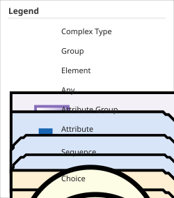

System Structure and Parameterization (SSP) is a tool independent standard to define complete systems consisting of one or more component models, including FMUs and their parameterization that can be transferred between simulation tools.

This specification, as well as supporting XML schema files, is provided on https://ssp-standard.org/[ssp-standard.org].
https://github.com/modelica/ssp-standard/releases[Releases] and https://github.com/modelica/ssp-standard/issues[issues] can be found on https://github.com/modelica/ssp-standard[github.com/modelica/ssp-standard].

Please report bugs, issues, and feature requests at https://github.com/modelica/ssp-standard/issues[github.com/modelica/ssp-standard/issues].
For non-public issues, contact the SSP development group at map-ssp_projectlead@googlegroups.com.

*History*

[width="100%",cols="18%,12%,70%",]
|===
|Version |Date |Remarks
|1.0 |2019-03-05 |First Public Release of SSP
|1.0.1 |2022-07-25 |Public Release of SSP 1.0.1
|2.0 |2024-12-20 |Public Release of SSP 2.0
|2.0.1 |2026-05-05 |Public Release of SSP 2.0.1
|===

*License of this document*

Copyright © 2016 – 2026 Modelica Association Project “SSP”

This document is licensed under the http://creativecommons.org/licenses/by-sa/4.0/[CC-BY-SA] (Creative Commons Attribution-Sharealike 4.0 International) license.
The XML schema files that accompany this document are licensed under the https://opensource.org/license/bsd-2-clause/[BSD 2-Clause license].
The license texts can be found in the link:LICENSE.txt[LICENSE.txt] file that accompanies this distribution.

Attention is drawn to the possibility that some of the elements of this document may be the subject of patent rights.
Modelica Association shall not be held responsible for identifying such patent rights.

*Abstract*

This document defines the SSP standard as a tool-independent format for the description, packaging and exchange of system structures and their parameterization.
The standard is comprised of a set of XML-based formats to describe a network of component models with their signal flow and parameterization, as well as a ZIP-based packaging format for efficient distribution of entire systems, including any referenced models and other resources.

*Conventions used in this Document*

* The key words *MUST*, *MUST NOT*, *REQUIRED*, *SHALL*, *SHALL NOT*, *SHOULD*, *SHOULD NOT*, *RECOMMENDED*, *MAY*, and *OPTIONAL* in this document are to be interpreted as described in RFC 2119 <<RFC2119>>.
* Non-normative text is given in a gray box like this one:
+
NOTE: Especially examples are defined in this style.

* The XML schema definitions throughout this document are illustrated using diagrams with the following notation:

